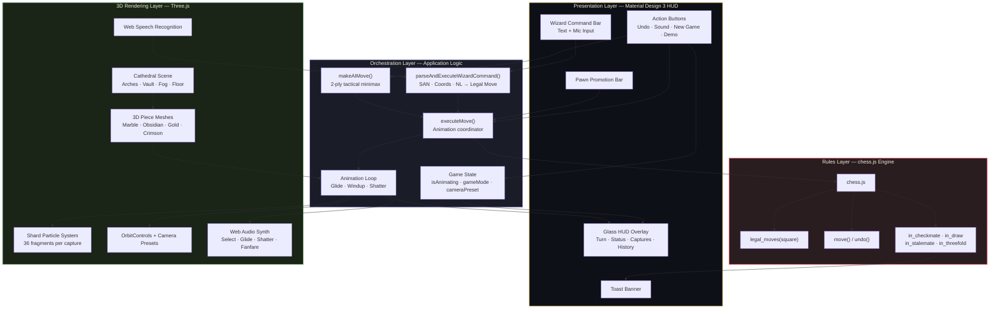
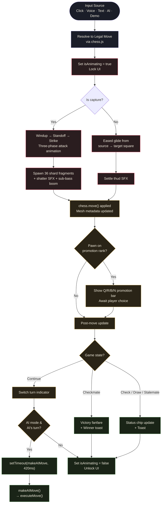
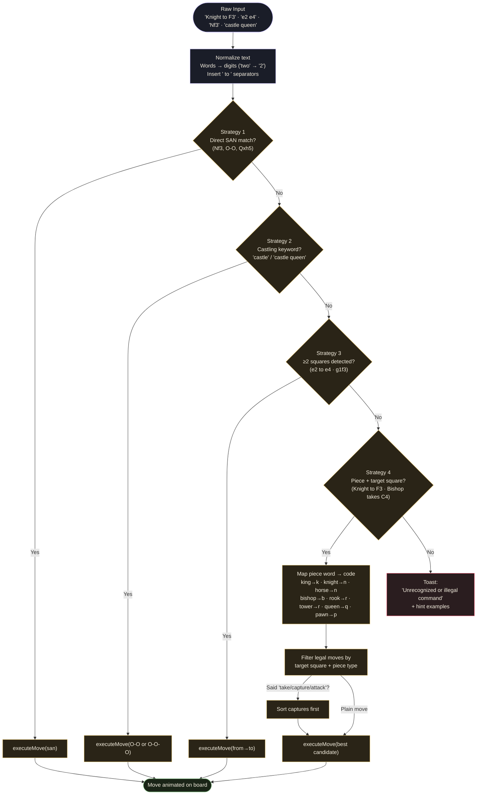
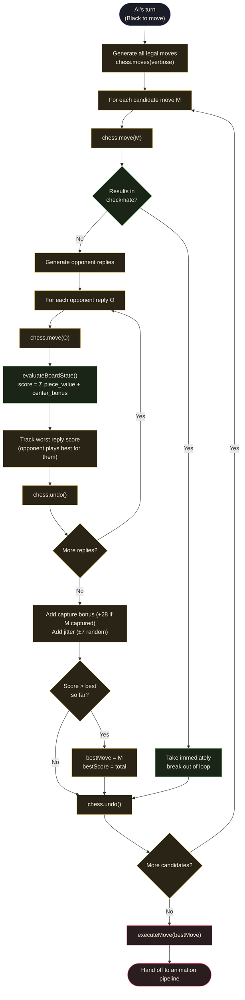

# Wizard's Chess — Minimalist Gothic Cathedral

> A real-time **3D wizard's chess experience** rendered inside a candle-lit Gothic cathedral, complete with marble & obsidian pieces, voice-cast spells, stone-shatter captures, and an intelligent tactical AI — all in a single self-contained HTML file.

<p align="center">
  <a href="https://wizard-chess-game.netlify.app/"></a>
  <a href="https://github.com/reenuasrin2008/wizards-chess-game"></a>
  
  
  
</p>

<p align="center">
  
  
  
  
  
</p>

---

## Table of Contents

- [Overview](#overview)
- [Key Features](#key-features)
- [Architecture at a Glance](#architecture-at-a-glance)
- [Move Execution Pipeline](#move-execution-pipeline)
- [Wizard Command Parser](#wizard-command-parser)
- [AI Opponent — Tactical Minimax](#ai-opponent--tactical-minimax)
- [Tech Stack](#tech-stack)
- [Quick Start](#quick-start)
- [How to Play](#how-to-play)
- [Audio System](#audio-system)
- [Project Structure](#project-structure)
- [Customization](#customization)
- [Browser Support](#browser-support)
- [Roadmap](#roadmap)
- [Credits & Acknowledgements](#credits--acknowledgements)
- [License](#license)

---

## Overview

**Wizard's Chess — Minimalist Gothic Cathedral** reimagines the classic game of chess as a cinematic, voice-driven ritual set inside an atmospheric stone cathedral. Built entirely as a single self-contained HTML file, it leverages the browser's native Web APIs — WebGL via Three.js, Web Audio, and Web Speech — to deliver a fully interactive 3D chess experience with no build step, no backend, and no external assets beyond CDN libraries.

The game pairs a **complete legal chess engine** (powered by [`chess.js`](https://github.com/jhlywa/chess.js)) with a **hand-built 3D cathedral scene** procedurally generated in Three.js — pointed Gothic arches, ribbed vaults, volumetric fog, and physically-based marble and obsidian materials. Pieces glide across the board with eased animation, and captures detonate the loser into **36 geometric shard fragments** that scatter through the air with custom physics. Every interaction is sonified by an on-the-fly **Web Audio synthesizer** that mimics stone sliding, crystal shattering, and a cathedral bell fanfare on victory.

Beyond the visuals, the signature feature is the **Wizard Command Bar**: players can speak or type moves in natural language — *"Knight to F3"*, *"E2 to E4"*, *"Castle kingside"*, *"Queen takes H5"* — and a layered parser resolves the utterance to a single legal move, animates it on the board, and (in AI mode) hands the turn to a 2-ply tactical opponent that evaluates captures, center control, and blunder avoidance. The result feels less like a chess client and more like casting incantations inside a living cathedral.

---

## Key Features

| Category | Feature |
|---|---|
| **Engine** | Complete legal chess via `chess.js` — castling, en passant, promotion, threefold repetition, insufficient material, stalemate, checkmate |
| **3D Scene** | Procedurally generated Gothic cathedral: pointed arches, vault ribs, fog, marble floor, dynamic spot lighting |
| **Materials** | `MeshPhysicalMaterial` marble & obsidian pieces with procedural stone-vein textures baked to canvas |
| **Animation** | Eased glide moves, windup-and-strike attack animations, 36-shard capture explosions with physics |
| **AI Opponent** | 2-ply tactical minimax with board evaluation (piece values + center control + capture bonus) |
| **Game Modes** | Vs AI (you play White) and 2-Player Local hot-seat |
| **Wizard Voice** | Web Speech API integration — speak moves hands-free |
| **Command Parser** | Accepts SAN (`Nf3`, `O-O`), coordinate pairs (`e2 to e4`, `g1f3`), and natural language (`Knight to F3`, `Bishop takes C4`) |
| **Cameras** | White-side, Black-side, Top-Down, and Cinematic Auto-rotate presets + free orbit |
| **Audio** | Web Audio synthesizer for select chimes, stone glide, shatter booms, and victory fanfares |
| **HUD** | Single-level Material Design 3 glass surface with Cinzel display font and Material Symbols |
| **Capture Counter** | Live tally of marble vs. obsidian pieces shattered |
| **Move History** | Scrollable single-line SAN strip |
| **Pawn Promotion** | Inline Q/R/B/N promotion bar appears automatically |
| **Undo** | Take back the last move (and the AI's reply) |
| **Demo Attack** | One-click showcase of the shatter animation |

---

## Architecture at a Glance

The entire application is a single HTML file split into four logical layers — a 3D rendering layer, a chess rules layer, a command/animation orchestration layer, and a presentation/HUD layer. All four communicate through a small set of shared module-level variables (`chess`, `scene`, `boardMeshes`, `isAnimating`, `gameMode`, `cameraPreset`).



---

## Move Execution Pipeline

Every move — whether from a click, a typed command, a spoken utterance, or the AI — flows through the same single entry point: `executeMove()`. This guarantees one source of truth for animation locking, sound playback, capture handling, and game-over detection.



---

## Wizard Command Parser

The signature feature of Wizard's Chess is its forgiving, multi-format command parser. A single utterance can travel up to four resolution strategies, in order from most-specific to most-permissive, before giving up and showing a friendly error toast.



### Command Examples

| Input style | Example | Resolution path |
|---|---|---|
| **Standard Algebraic Notation** | `Nf3`, `e4`, `Qxh5`, `O-O`, `O-O-O` | Strategy 1 — direct SAN match |
| **Castling natural language** | `castle`, `castle kingside`, `castle queenside` | Strategy 2 — keyword + legal castling move |
| **Coordinate pair** | `e2 to e4`, `e2 e4`, `g1f3`, `e2→e4` | Strategy 3 — two squares detected |
| **Piece + target** | `Knight to F3`, `Bishop takes C4`, `Queen H5` | Strategy 4 — piece-word map + target filter |
| **Voice synonyms** | `Horse to F3` (knight), `Tower to A1` (rook) | Strategy 4 — synonym map resolves to piece code |

---

## AI Opponent — Tactical Minimax

The built-in AI uses a **2-ply tactical search**: for every legal move it can make, it simulates the opponent's best reply and scores the resulting position. The evaluation combines material values, center control, capture bonuses, and a small random jitter so the AI doesn't always play the same opening.



### Evaluation Function

```
score(M) = min over opponent replies O of evaluateBoardState(after O)
         + 28                  if M captures a piece
         + random(-7, +7)      for variety

evaluateBoardState() = Σ over board squares of:
    (PIECE_VALUE[type] + center_bonus(square)) × (+1 if Black, -1 if White)

PIECE_VALUES = { p: 100, n: 320, b: 330, r: 500, q: 900, k: 20000 }
center_bonus = (3.5 - |3.5 - file|) × 4 + (3.5 - |3.5 - rank|) × 4
```

The AI favors captures, centralizes pieces, avoids leaving high-value material hanging, and refuses to miss a checkmate — but its shallow search depth means strong human players will outmaneuver it in the mid-game. It is intentionally tuned to be **challenging but beatable**, perfect for a casual ritual match.

---

## Tech Stack

| Layer | Technology | Role |
|---|---|---|
| 3D rendering | [Three.js r128](https://threejs.org/) | Scene graph, materials, lighting, camera, particle shards |
| Camera controls | `OrbitControls.js` (Three.js addon) | Free orbit + zoom around the cathedral |
| Chess rules | [chess.js 0.10.3](https://github.com/jhlywa/chess.js) | Legal move generation, check/checkmate/draw detection, SAN |
| Styling | [Tailwind CSS](https://tailwindcss.com/) (CDN) | Utility-first Material Design 3 glass surfaces |
| Typography | Google Fonts: Cinzel, Plus Jakarta Sans, JetBrains Mono | Gothic display, body, monospace |
| Icons | Material Symbols Outlined | Inline HUD iconography |
| Audio | Web Audio API | Procedural synth — no audio files |
| Voice | Web Speech API (`SpeechRecognition`) | Hands-free Wizard commands |
| Packaging | Single self-contained HTML file | No build step, no dependencies installed |

---

## Quick Start

Wizard's Chess is a single HTML file with zero build pipeline. You can run it in three ways:

### Option 1 — Play the live demo

Visit **<https://wizard-chess-game.netlify.app/>** — that's it. Click anywhere on the page to unlock audio (browsers require a user gesture).

### Option 2 — Clone and open

```bash
git clone https://github.com/reenuasrin2008/wizards-chess-game.git
cd wizards-chess-game
# Then open index.html (or wizard_s_chess_minimalist_gothic_cathedral.html) in any modern browser:
open wizard_s_chess_minimalist_gothic_cathedral.html    # macOS
xdg-open wizard_s_chess_minimalist_gothic_cathedral.html  # Linux
start wizard_s_chess_minimalist_gothic_cathedral.html   # Windows
```

### Option 3 — Serve locally (recommended for Speech API)

Some browsers restrict Web Speech API on `file://` URLs. To enable voice commands locally, serve the file over HTTP:

```bash
# Python 3
python3 -m http.server 8000
# Then visit http://localhost:8000/wizard_s_chess_minimalist_gothic_cathedral.html

# Or with Node.js
npx serve .
```

> The repository contains **only the HTML file** — no `package.json`, no `node_modules`, no install step. Everything (Three.js, chess.js, Tailwind, fonts) is loaded from CDNs.

---

## How to Play

### Starting a Game

1. Open the page in a modern browser (Chrome or Edge recommended for voice support).
2. Choose a mode in the top-right segmented button:
   - **Vs AI** — You play White against the tactical minimax opponent.
   - **2P Local** — Two humans share one device, hot-seat style.
3. Pick a camera preset: **White**, **Black**, **Top-Down**, or **Cinematic Auto**.

### Making a Move

You have three equivalent ways to move pieces:

| Method | How |
|---|---|
| **Click** | Click your piece → click any highlighted destination square |
| **Type** | Type into the Wizard Command Bar (bottom-center) and press **Cast** or Enter |
| **Speak** | Click the 🎤 mic icon, then say e.g. *"Knight to F3"* — recognized live |

### Voice Command Examples

```
"E2 to E4"            — coordinate pair
"Knight to F3"        — piece + target square
"Bishop takes C4"     — piece + capture + target
"Castle kingside"     — castling natural language
"Queen H5"            — piece + target (no preposition)
"O-O"                 — direct SAN
"Nf3"                 — direct SAN (compact)
"Horse to F3"         — synonym for Knight
```

### Other Controls

- **Undo Move** — take back the last move (and the AI's reply in Vs AI mode)
- **Sound On/Off** — toggle the Web Audio synthesizer
- **New Game** — reset the board to the starting position
- **Demo Attack / Shatter** — instantly triggers a showcase capture to demo the shatter animation
- **Promotion Bar** — appears automatically when a pawn reaches the last rank; pick Q / R / B / N

---

## Audio System

All sound is synthesized **procedurally** with the Web Audio API — there are no audio files, no assets to load, and no network requests for sound. The `WizardAudioEngine` class produces four distinct soundscape elements:

| Sound | Synthesis | Trigger |
|---|---|---|
| **Select chime** | Sine oscillator 520 → 780 Hz exponential sweep, 160 ms decay | Clicking a piece |
| **Stone glide** | Filtered noise burst (bandpass 240 → 380 → 190 Hz), 450 ms | Piece moving across the board |
| **Stone thud** | Triangle oscillator 115 → 42 Hz, settling impact | Piece lands on destination |
| **Shatter boom** | Sine oscillator 80 → 35 Hz sub-bass + 12 randomized crystal pings (900–3100 Hz) | A piece is captured |
| **Victory fanfare** | Layered oscillators in a major chord arpeggio | Checkmate |

Audio is initialized lazily on the first user interaction (required by all modern browsers' autoplay policies) and can be toggled off at any time via the **Sound** button.

---

## Project Structure

```
wizards-chess-game/
├── wizard_s_chess_minimalist_gothic_cathedral.html   # The entire game (~2,300 lines)
├── README.md                                          # This file
└── LICENSE                                            # MIT
```

Inside the single HTML file, the JavaScript is organized into 10 numbered sections:

```
 1. WizardAudioEngine              — Web Audio synth class
 2. Procedural textures            — Canvas-baked stone-vein materials
 3. Scene setup                    — Three.js scene, fog, lights, camera
 4. Cathedral construction         — Arches, vault ribs, floor
 5. Piece & board mesh creation    — Marble/obsidian/gold/crimson materials
 6. Input handlers                 — Mouse / touch picking & OrbitControls
 7. Move execution & animation     — Glide, windup, strike, shatter
 8. Pawn promotion                 — Inline Q/R/B/N picker
 9. AI opponent                    — 2-ply tactical minimax
10. Wizard command parser          — SAN · coords · natural language
```

---

## Customization

Because everything lives in one HTML file, tweaking the experience is straightforward. A few common knobs:

| Want to change… | Find… | Edit |
|---|---|---|
| Cathedral atmosphere | `scene.fog = new THREE.FogExp2(0x090b11, 0.022);` | Adjust fog color/density |
| Material palette | `marbleMaterial`, `obsidianMaterial`, `goldAccentMat`, `crimsonAccentMat` | Swap colors or roughness/metalness |
| AI difficulty | `makeAIMove()` | Increase ply depth or remove random jitter |
| Capture shard count | `const shardCount = 36;` inside the shatter function | Spawn more/fewer fragments |
| Default camera preset | `let cameraPreset = 'cinematic';` | Change initial view |
| Sound levels | `gain.gain.setValueAtTime(...)` across `WizardAudioEngine` | Lower/raise volume |
| Voice language | `recognition.lang` inside `toggleSpeechRecognition()` | Set e.g. `'en-GB'`, `'hi-IN'` |

---

## Browser Support

| Browser | 3D / Animation | Voice Commands | Audio | Recommended? |
|---|---|---|---|---|
| **Chrome 90+** | ✅ | ✅ | ✅ | Best experience |
| **Edge 90+** | ✅ | ✅ | ✅ | Best experience |
| **Firefox 90+** | ✅ | ❌ (no `SpeechRecognition`) | ✅ | Good — typing only |
| **Safari 15+** | ✅ | ⚠️ (prefixed `webkitSpeechRecognition`) | ✅ | Mostly works |
| **Mobile Chrome (Android)** | ✅ | ✅ | ✅ | Touch input supported |
| **Mobile Safari (iOS)** | ⚠️ (heavier scene) | ⚠️ | ✅ | Works but warmer on battery |

> **Note:** Web Speech API is currently supported only in Chromium-based browsers (Chrome, Edge, Brave). In unsupported browsers, the mic button will show a friendly toast and the typed command bar remains fully functional.

---

## Roadmap

- [ ] Online multiplayer via WebRTC peer-to-peer
- [ ] Configurable AI difficulty levels (Casual / Adept / Master)
- [ ] Opening book for stronger AI openings
- [ ] Save/load game state to `localStorage`
- [ ] PGN export of completed games
- [ ] Multiple cathedral environments (Romanesque, Baroque, Ruined)
- [ ] Move hints (highlight best move for the current player)
- [ ] Accessibility mode (high-contrast pieces, keyboard-only navigation)

---

## Credits & Acknowledgements

- **[chess.js](https://github.com/jhlywa/chess.js)** by Jeff Hlywa — the legal chess move generator that powers all rules
- **[Three.js](https://threejs.org/)** by Ricardo Cabello (Mr.doob) and contributors — WebGL made humane
- **[Tailwind CSS](https://tailwindcss.com/)** by Adam Wathan and team — utility-first styling
- **Google Fonts** — Cinzel (Cathedral display), Plus Jakarta Sans (body), JetBrains Mono (notation)
- **Material Symbols** — Google's open-source icon set
- Inspired by the Wizard's Chess scene in *Harry Potter and the Philosopher's Stone* and by the timeless ritual of chess itself

---

## License

Released under the **MIT License**. See [`LICENSE`](./LICENSE) for the full text.

```
MIT License

Copyright (c) 2025 Wizard's Chess Contributors

Permission is hereby granted, free of charge, to any person obtaining a copy
of this software and associated documentation files (the "Software"), to deal
in the Software without restriction, including without limitation the rights
to use, copy, modify, merge, publish, distribute, sublicense, and/or sell
copies of the Software, and to permit persons to whom the Software is
furnished to do so, subject to the following conditions:

The above copyright notice and this permission notice shall be included in all
copies or substantial portions of the Software.

THE SOFTWARE IS PROVIDED "AS IS", WITHOUT WARRANTY OF ANY KIND, EXPRESS OR
IMPLIED, INCLUDING BUT NOT LIMITED TO THE WARRANTIES OF MERCHANTABILITY,
FITNESS FOR A PARTICULAR PURPOSE AND NONINFRINGEMENT. IN NO EVENT SHALL THE
AUTHORS OR COPYRIGHT HOLDERS BE LIABLE FOR ANY CLAIM, DAMAGES OR OTHER
LIABILITY, WHETHER IN AN ACTION OF CONTRACT, TORT OR OTHERWISE, ARISING FROM,
OUT OF OR IN CONNECTION WITH THE SOFTWARE OR THE USE OR OTHER DEALINGS IN THE
SOFTWARE.
```

---

<p align="center">
  <em>Cast your move. Shatter the marble. Let the cathedral decide.</em>
</p>
